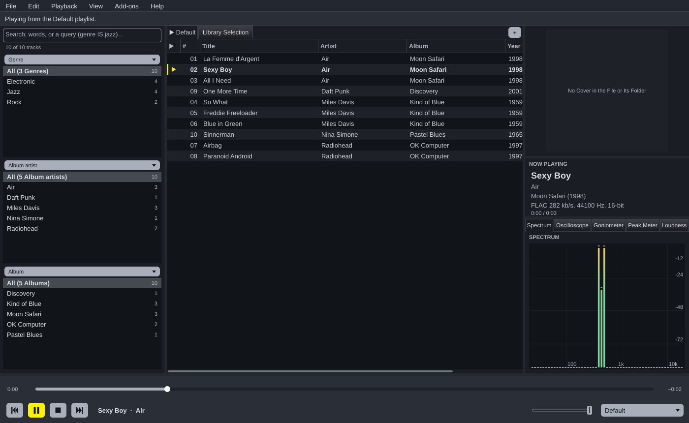
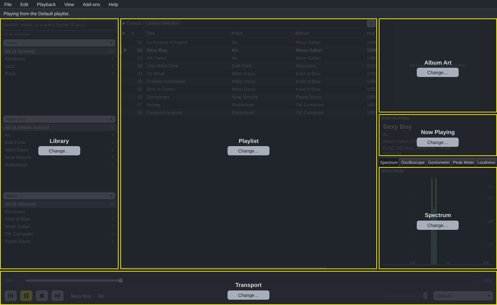

# Kalibre Player

A music player for Apple silicon Macs, made from [Kalibre](https://github.com/KallumS/Kalibre)
(the DAW): its look, its themes, its loudness meter and its Lua, around a
player in the spirit of foobar2000 and VLC. Everything happens in one window,
laid out as you like.



## What's in it

**Playback**
- **Every common format, built in**: MP1, MP2, MP3, Musepack, AAC, WMA (and
  WMA Pro and Lossless), Ogg Vorbis, FLAC and Ogg FLAC, ALAC, WavPack, WAV,
  AIFF, AU and SND, Speex and Opus; and Monkey's Audio, TTA, TAK, AC-3, DTS,
  DSD and Matroska audio besides. Decoded by FFmpeg, inside the app.
- **Audio CDs**: File > Play Audio CD.
- **Inside archives**: music in ZIP, RAR, 7-Zip, tar and gzip files plays,
  and is in the library, without unpacking.
- **Gapless**: one track's last sample is followed by the next one's first
  (encoder padding in MP3, AAC and Opus is cut).
- **ReplayGain**: by track, by album, or by album when an album plays in
  order; with a preamp, and turned down if it would clip. Tracks without
  ReplayGain tags are measured as they're queued, so they're levelled too.
- **DSP**: a ten-band equaliser with presets, crossfading between tracks,
  and **AU and VST3 effects** in a chain.
- **Meters**: oscilloscope, goniometer with correlation, spectrum, peak and
  RMS meter, and an EBU R128 loudness meter.
- Play/pause, next and previous on the keyboard's media keys, AirPods and
  Control Centre.

**Library, tags and files**
- **A library that watches its folders**: what's added, changed or removed
  there appears at once (macOS tells the player).
- **Search** with words or foobar2000's queries (`genre IS jazz AND date
  BEFORE 1970`), and **browse** by genre, artist, album, year or any field.
  **Autoplaylists** hold what a query finds.
- **Tag editor** for many tracks at once; **tags from file names**;
  **rename, move or copy files** by a pattern (`%album artist%/%album%/%tracknumber% - %title%`).
- **Title formatting** as foobar2000's, for columns, file names and Now Playing.
- **Convert** to FLAC, ALAC, WavPack, WAV, AIFF, MP3 (LAME), AAC, Opus and
  Ogg Vorbis, on every core, tags and covers kept. **Rip CDs**, named and
  tagged from MusicBrainz.
- **ReplayGain scanning** by track or album, written to the tags.

**Yours to arrange**
- **The layout**: View > Edit Layout, then replace any panel, put another
  beside it or in tabs with it, or take it out; drag the dividers. Five
  layouts to start from.
- **A mini player** (View > Mini Player): a small strip in front of other windows.
- **Kalibre's twelve themes**, and the text size.
- **Keyboard shortcuts** for everything, changed in Preferences.
- **Add-ons in Lua**: File > Import Add-on. They add menu items, react to
  what plays, read and write tags, and build playlists
  ([docs/ADD-ONS.md](docs/ADD-ONS.md)). Four examples come with it.



## Getting it

From [Actions](../../actions) > Build > the latest run > **KalibrePlayer-macOS**,
or a release. Open the .dmg, drag Kalibre Player to Applications, and the
first time right-click it and choose Open. [docs/INSTALL-MAC.txt](docs/INSTALL-MAC.txt)
has the rest.

## Building it

```sh
./build-mac.command          # on a Mac with Xcode's command line tools and CMake
```

The first build also builds FFmpeg, LAME and libopus (a few minutes, once).
[CLAUDE.md](CLAUDE.md) has the commands for the tests.

## The docs

- [docs/USER-GUIDE.md](docs/USER-GUIDE.md): every function, menu and key.
- [docs/FEATURES.md](docs/FEATURES.md): what's done and what isn't.
- [docs/ARCHITECTURE.md](docs/ARCHITECTURE.md): how it's built.
- [docs/TITLE-FORMATTING.md](docs/TITLE-FORMATTING.md), [docs/QUERIES.md](docs/QUERIES.md), [docs/ADD-ONS.md](docs/ADD-ONS.md).
- [docs/decisions/](docs/decisions/): why it's built so.
- [docs/CHANGES.md](docs/CHANGES.md): each version.

## Licence

GPL-3.0, as Kalibre. It's built with FFmpeg (LGPL-2.1), LAME (LGPL-2.0),
libopus (BSD), TagLib (LGPL-2.1/MPL-1.1), libarchive (BSD), Lua (MIT),
nlohmann/json (MIT) and JUCE.
