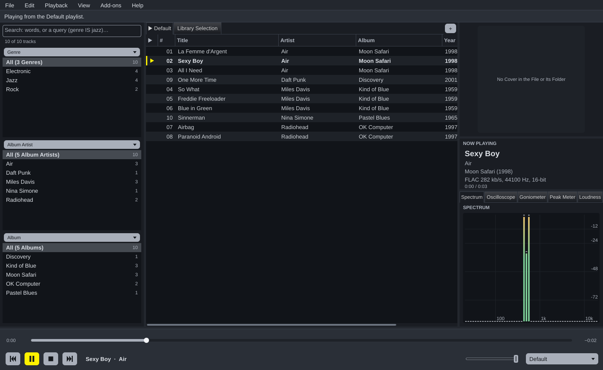
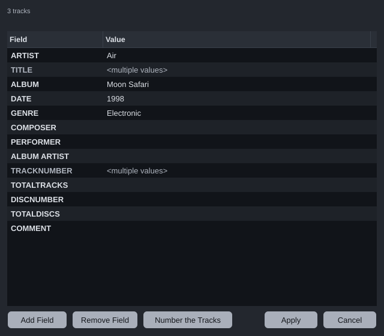
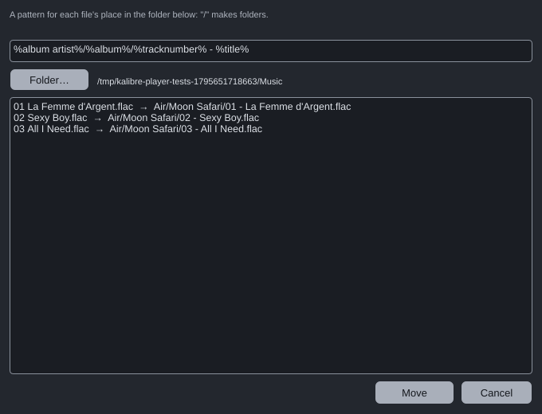
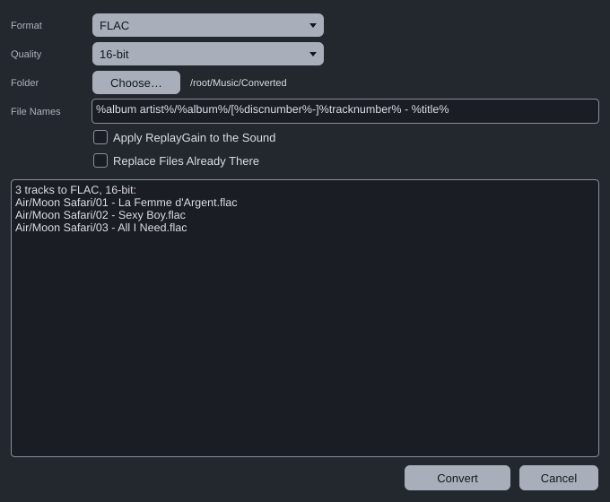
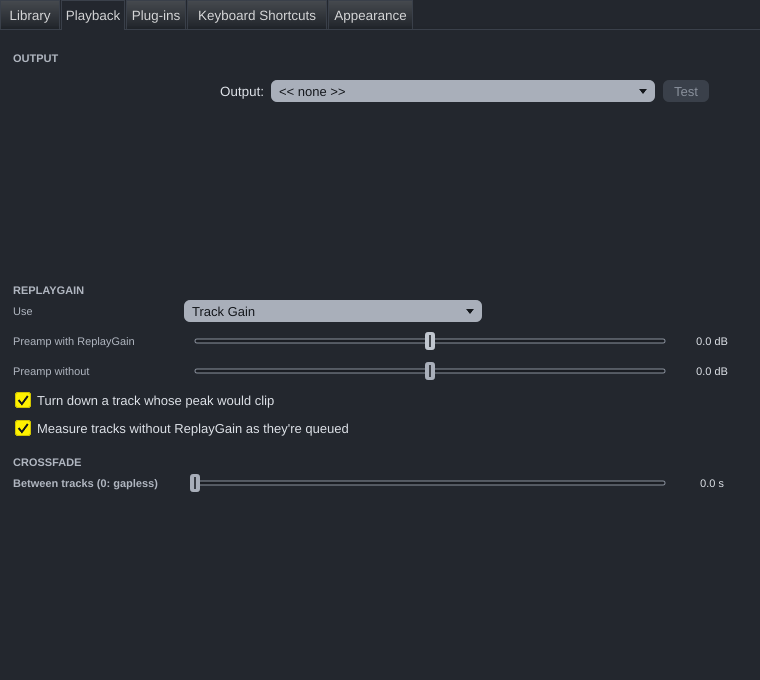
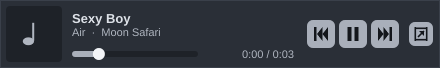
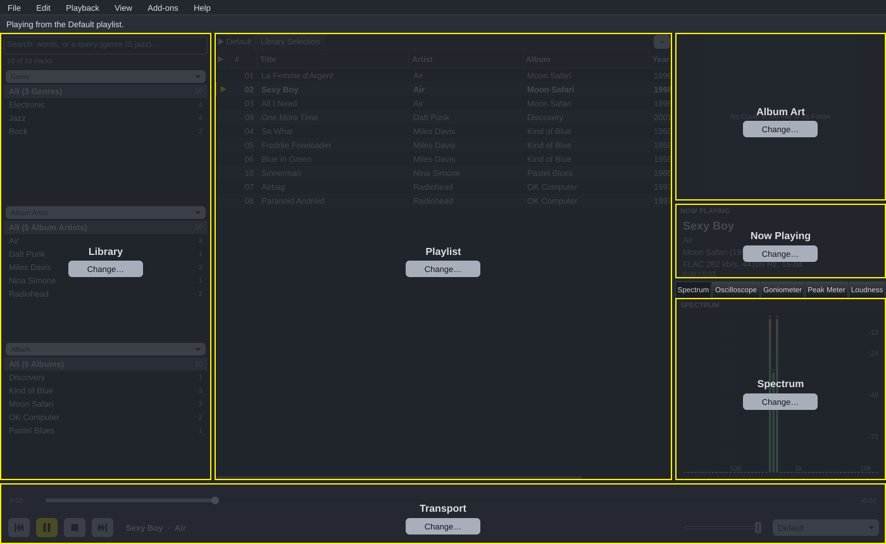
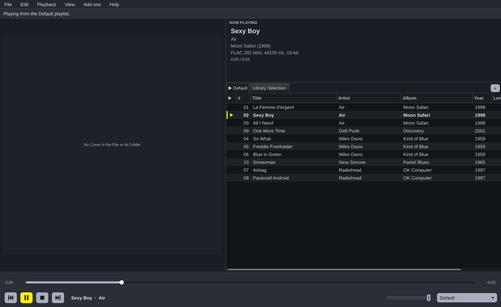
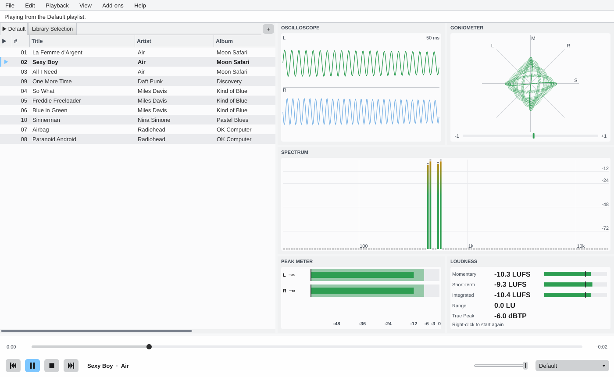
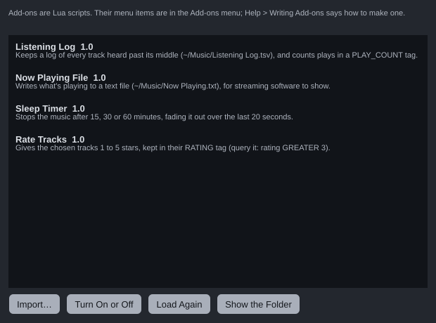

# Kalibre Player: the guide

Kalibre Player plays, organises, tags and converts your music, on an Apple
silicon Mac, Windows or Linux. This guide covers every part of it.

The keys are written as a Mac has them. **On Windows and Linux, Command is
Ctrl and Option is Alt** (Command-O is Ctrl+O), and Preferences is in the
File menu rather than the Kalibre Player menu.



**Contents**

1. [Getting it and starting](#1-getting-it-and-starting)
2. [The window](#2-the-window)
3. [Playing](#3-playing)
4. [Playlists](#4-playlists)
5. [The library](#5-the-library)
6. [Tags](#6-tags)
7. [Renaming, moving and copying files](#7-renaming-moving-and-copying-files)
8. [Converting](#8-converting)
9. [Audio CDs](#9-audio-cds)
10. [ReplayGain](#10-replaygain)
11. [Sound: equaliser, crossfade, plug-ins, output](#11-sound-equaliser-crossfade-plug-ins-output)
12. [Meters](#12-meters)
13. [The mini player](#13-the-mini-player)
14. [The layout and themes](#14-the-layout-and-themes)
15. [Keyboard shortcuts](#15-keyboard-shortcuts)
16. [Add-ons](#16-add-ons)
17. [Preferences](#17-preferences)
18. [Where things are kept](#18-where-things-are-kept)
19. [When something's wrong](#19-when-somethings-wrong)

---

## 1. Getting it and starting

Download the latest build from the project's **Actions** page (Build > the
latest run > Artifacts), or from a release.

| System | Download | Installing |
|---|---|---|
| Mac (Apple silicon, macOS 12 or later) | **KalibrePlayer-macOS** (.dmg) | Open it and drag Kalibre Player into Applications. The first time, right-click it and choose **Open**, then Open again (it isn't signed with an Apple Developer ID yet). |
| Windows 10 or 11 (64-bit) | **KalibrePlayer-Windows** (.zip) | Unzip it anywhere and run **Kalibre Player.exe**; nothing else to install. If Windows says it protected your PC, click **More info** then **Run anyway**. |
| Linux (64-bit; Ubuntu 24.04, Fedora 40 or newer) | **KalibrePlayer-Linux** (.tar.gz) | `tar -xzf KalibrePlayer-Linux.tar.gz`, then run `install.sh` inside: it's in your applications menu after, and `kalibre-player` starts it. No administrator needed. |

The first time it opens, the message line at the top says how to begin:

1. **Add your music**: click **Add a Folder…** in the library (left). The
   library reads it and watches it from then on.
2. **Double-click a track** to play it. **Space** plays and pauses.

You can also drop files, folders, archives or playlists straight onto the
playlist, or open them with **File > Open…** (Command-O).

## 2. The window

From the top:

- **The menus** (on a Mac, in the menu bar at the top of the screen).
- **The message line** says what just happened ("12 tracks added") and, on
  the right, any work going on ("Converting 3 of 40") with a **Stop**
  button. Click a message to dismiss it.
- **The panels**, laid out as you choose ([section 14](#14-the-layout-and-themes)).
  The first layout has the library on the left; the playlist in the middle;
  and on the right the cover, Now Playing and the meters as tabs.
- **The transport** at the bottom: Previous, Play/Pause, Stop and Next; the
  seek bar with the time played and left; what's playing; the volume
  (double-click it for 0 dB); and the order.

**Now Playing** shows the title, artist, album, format and time. Right-click
it to change what it shows (a [title-formatting](TITLE-FORMATTING.md) pattern;
`$crlf()` starts a new line).

**Album art** shows the cover inside the file, or a cover.jpg, folder.jpg or
front.jpg beside it.

## 3. Playing

- **Double-click** a track, or choose it and press **Return**.
- **Space**: play and pause. **Command-.**: stop.
- **Command-Right / Command-Left**: next and previous. Previous goes back to
  the start of the track first if more than 3 seconds have played.
- **Command-Shift-Right / Command-Shift-Left**: 5 seconds on or back. Or
  click or drag anywhere on the seek bar.
- **Command-Up / Command-Down**: louder and quieter. **Command-Option-Down**:
  mute.
- **The media keys** on your keyboard (Mac and Windows), AirPods and the Mac's
  Control Centre also play, pause and skip.
- **Q** (Edit > Play Next) queues the chosen tracks to play straight after
  this one. The playlist's first column numbers them.
- **The order** (the transport's menu, or Playback > Order):

  | Order | What plays next |
  |---|---|
  | Default | The next in the playlist; it stops at the end |
  | Repeat Playlist | The next, and back to the start at the end |
  | Repeat Track | The same track again (Next still moves on) |
  | Shuffle Tracks | A random track, each heard once before any is heard again; Previous goes back through them |
  | Shuffle Albums | A random album, its tracks in their own order |
  | Random | Any track, at random |

- **Playback > Stop After This Track** and **Play a Random Track**.
- Tracks follow one another **without a gap** (a live album plays as one),
  unless you set a crossfade ([section 11](#11-sound-equaliser-crossfade-plug-ins-output)).

**What it plays**: MP1, MP2, MP3, Musepack, AAC, WMA (and WMA Pro and
Lossless), Ogg Vorbis, FLAC and Ogg FLAC, ALAC, WavPack, WAV, AIFF, AU, SND,
Speex and Opus; also Monkey's Audio, TTA, TAK, AC-3, DTS, DSD and Matroska
audio. And music **inside ZIP, RAR, 7-Zip, tar and gzip files**, without
unpacking them: drop the archive on the playlist or keep it in a library
folder.

## 4. Playlists

- Playlists are **tabs** along the top of the playlist; **+** makes a new
  one (Command-N). The tab playing shows ▶.
- **Right-click a tab**: Rename…, Save as M3U…, Remove.
- **File > Load Playlist…** opens M3U, M3U8 and PLS files as new playlists;
  **File > Save Playlist…** (Command-S) saves the one shown as M3U8.
- **Drop** files, folders or archives from the Finder or File Explorer onto
  the playlist, where you want them. **Drag** tracks to move them.
- **Click a column's header** to sort by it (again for the other way).
  **Right-click the header** to add a column of any field or pattern (such as
  `%genre%` or `%codec% %bitrate%`), change one or remove one. Drag headers
  to reorder, and their edges to resize.
- **Right-click tracks**: Play, Play Next, Edit Tags, Files (rename, move,
  copy, show in the Finder or File Explorer, copy their paths), Convert,
  ReplayGain, the add-ons' items, Remove.
- **Edit menu**: Select All, Remove from Playlist (Delete), Keep Only the
  Chosen, Remove Duplicates, Remove Missing Files, Sort (by artist, album,
  title, file path, or shuffled).

**Autoplaylists** (File > New Autoplaylist…, Command-Shift-N) hold whatever
a search query finds, and follow the library as it changes: "genre IS jazz",
"added DURING LAST 2 WEEKS", "rating GREATER 3". Right-click the tab and
choose **Make It a Playlist of Its Own** to freeze one.

## 5. The library

- **Add a folder**: **Add a Folder…** in the library panel, or
  Preferences > Library. Add as many as you like. The library **watches**
  them: music added, changed or removed there shows up within seconds.
  **File > Look Through the Library Again** reads everything afresh.
- **Search** (Command-F): type words to find tracks with all of them
  anywhere ("miles blue"), or a query to find exactly:

  ```
  genre IS jazz AND date BEFORE 1965
  artist HAS beatles
  rating GREATER 3
  comment MISSING
  added DURING LAST 2 WEEKS
  %album artist% IS %artist%
  ALL SORT BY %date%
  ```

  Help > Search Queries, or [QUERIES.md](QUERIES.md), lists them all.
- **Browse**: under the search are three columns, by default **Genre**,
  **Album Artist** and **Album**. Choose a value in one and the next narrows
  to it. Each column's menu at its top changes its field (Artist, Year,
  Composer, Date, Codec, Folder, or **Other Field…** for any tag or pattern).
  Command-click to choose several values.
- What you choose fills the **Library Selection** playlist. **Double-click**
  (or Return) plays it. **Right-click** a value: Play, Add to the Playlist
  Shown, Send to a New Playlist, Play Next.

## 6. Tags

**Edit Tags** (Command-I, or right-click > Edit Tags…) shows every field of
the chosen tracks.



- A field that differs between the tracks shows **<multiple values>** and
  stays as each track has it unless you change it.
- **Double-click** a value (or a field's name) to change it. For several
  values in one field, put `; ` between them ("Rock; Pop").
- **Add Field** for any field (mood, label, rating); **Remove Field** takes
  one out of every chosen track.
- **Number the Tracks** gives them 1, 2, 3… in the playlist's order, with
  the total.
- **Apply** writes the tags. Files inside archives can be read but not
  changed.

**Tags from File Names** (Edit menu) reads tags from the files' names with a
pattern such as `%tracknumber% - %artist% - %title%`, or with folders:
`%artist%/%album%/%tracknumber% %title%`. The preview shows what each file
gives before you apply it.

The tags work the same in every format: ID3 in MP3, Vorbis comments in FLAC,
Ogg and Opus, MP4 atoms in AAC and ALAC, APE tags, WMA's and WAV's and
AIFF's own.

## 7. Renaming, moving and copying files

**Edit > Rename Files…, Move Files…, Copy Files…** (or right-click > Files)
use a [title-formatting](TITLE-FORMATTING.md) pattern for each file's new
name (rename) or place (move and copy; `/` makes folders):

```
%album artist%/[%date% - ]%album%/[%discnumber%-]%tracknumber% - %title%
```



The preview shows every file's new name before anything changes. A name is
never given to a file already there. Characters a file name can't hold
(`/ : ? *`) become `_`, so "AC/DC" makes a folder "AC_DC". Playlists and the
library follow the files to their new places; a folder left empty by a move
is taken away.

## 8. Converting

**Edit > Convert…** (Command-Shift-K) converts the chosen tracks.



- **Format**: FLAC, Apple Lossless (ALAC), WavPack, WAV or AIFF (16 or
  24-bit); MP3 (LAME: VBR V0 to V6, or a constant 128 to 320 kb/s); AAC,
  Opus (64 to 320 kb/s); Ogg Vorbis (quality 0 to 10).
- **Folder**, and **File Names**: a pattern, as for moving files.
- **Apply ReplayGain to the Sound** levels the files themselves (and leaves
  the ReplayGain tags out). **Replace Files Already There** overwrites.
- Tags and covers go with the files. It uses every core; the message line
  shows how far it's got, with **Stop**.

## 9. Audio CDs

Put a CD in the drive, then:

- **File > Play Audio CD** makes a playlist of the disc and plays it.
- **File > Rip Audio CD…** asks MusicBrainz for the album and its tracks.
  Change any name before you rip (double-click a title or artist). Then
  choose a format, folder and names as for converting, and click **Rip**.

On a Mac the CD is read as macOS shows it; on Windows and Linux the player
reads the drive itself. On some Linux systems you need to be in the "cdrom"
group to read CDs.

## 10. ReplayGain

ReplayGain plays every track at the same loudness, so you don't reach for
the volume between a quiet old record and a loud new one.

- **Playback > ReplayGain**: **by Track**, **by Album** (an album's quiet and
  loud songs stay so), or **by Album When Playing Albums** (album gain when an
  album plays in order, track gain when shuffling).
- **Tracks without ReplayGain** are measured as they're queued, so they're
  levelled too, without writing anything to the files.
- **Scanning**: Edit > ReplayGain > **Scan per Track** or **Scan as Albums**
  (grouped by their album tags) measures the chosen tracks and writes the
  tags. **Remove ReplayGain Tags** takes them out.
- Preferences > Playback has the **preamps** (louder or quieter overall,
  with and without ReplayGain) and **Turn down a track whose peak would clip**.

## 11. Sound: equaliser, crossfade, plug-ins, output

- **Equaliser**: add the Equaliser panel with View > Edit Layout (the
  Mastering Desk layout has it). Ten bands from 31 Hz to 16 kHz, each ±12 dB,
  a preamp, **Presets** (Bass Boost, Vocal, Loudness, Headphones…) and **On**.
  Double-click a slider for 0 dB. Playback > Equaliser On turns it on and off.
- **Crossfade**: Preferences > Playback > Crossfade, 0 to 12 seconds. At 0,
  tracks follow without a gap.
- **Plug-ins** (AU on the Mac, VST3 everywhere): Preferences > Plug-ins.
  Scan once (the **Options** button > Scan for New or Updated…); a plug-in
  that crashes while scanning is skipped next time. Then **Add…** puts an
  effect in the chain; **Open…** (or double-click) shows its window; **Bypass**,
  **Up**, **Down**, **Remove**. The sound passes through the equaliser, then the
  plug-ins top to bottom, then the volume. The chain and its settings are kept.
- **Output**: Preferences > Playback chooses the device and its buffer.



## 12. Meters

Each is a panel (add them with View > Edit Layout, or choose the
**Visualisers** layout). They show what you hear, after the equaliser,
plug-ins and volume.


| Meter | What it shows |
|---|---|
| Oscilloscope | The waveform, left above and right below. Right-click: 10 to 250 ms across. |
| Goniometer | Left against right: mono is a vertical line, wide sound a cloud, out-of-phase sound lies sideways. Under it, the correlation from -1 (out of phase) to +1 (mono). |
| Spectrum | 20 Hz to 20 kHz, with peaks held a moment. Right-click: bars or a line. |
| Peak Meter | Each channel's peak (light) and RMS (solid), the held peak (a line) and a red mark if it clipped. Click to clear them. |
| Loudness | EBU R128: momentary, short-term and integrated LUFS, loudness range and true peak, with -14 LUFS (streaming's level) marked. Right-click to start the integrated reading again. |

## 13. The mini player

**View > Mini Player** (Command-Shift-M) makes the window a small strip:
the cover, title and artist, the seek bar and time, and Previous,
Play/Pause and Next.



- It stays **in front** of other windows. Right-click it and untick **Keep
  in Front** to stop that.
- **Drag** it by its background to move it; it opens there next time.
- The **button on its right**, a double-click, or Command-Shift-M again
  brings back the full window, where and as it was.
- Every key still works while it's small. If you quit while it's small, the
  player opens small.

## 14. The layout and themes

**View > Edit Layout** (Command-E) shows each panel's name with a
**Change…** button:



- **Replace With**: any other panel.
- **Add to the Left / Right, Add Above / Below**: a new panel beside it.
- **Add as a Tab**: the two share the place, as tabs.
- **Remove**.

Drag the dividers between panels to resize them. Press Command-E again when
it's done; the layout is kept.

The panels: Playlist, Library, Album Art, Now Playing, Transport, Equaliser,
Oscilloscope, Goniometer, Spectrum, Peak Meter, Loudness, Add-on Console.

**View > Layout** has five ready-made layouts: **Library and Playlist**,
**Playlist Only**, **Visualisers**, **Album Art** and **Mastering Desk**.



**View > Theme** has Kalibre's twelve themes; **Command-=** and **Command--**
make the text bigger and smaller (also in Preferences > Appearance).



## 15. Keyboard shortcuts

Change any of them in **Preferences > Keyboard Shortcuts**: click **+** beside
a command and press the keys. They're kept.

| Command | Mac | Windows and Linux |
|---|---|---|
| Play/Pause | Space | Space |
| Stop | Command-. | Ctrl+. |
| Next / Previous | Command-Right / Command-Left | Ctrl+Right / Ctrl+Left |
| Forward / back 5 seconds | Command-Shift-Right / Left | Ctrl+Shift+Right / Left |
| Louder / quieter | Command-Up / Command-Down | Ctrl+Up / Ctrl+Down |
| Mute | Command-Option-Down | Ctrl+Alt+Down |
| Play Next (queue) | Q | Q |
| Open… / Add Files… | Command-O / Command-Shift-O | Ctrl+O / Ctrl+Shift+O |
| New Playlist / New Autoplaylist… | Command-N / Command-Shift-N | Ctrl+N / Ctrl+Shift+N |
| Save Playlist… | Command-S | Ctrl+S |
| Remove Playlist | Command-W | Ctrl+W |
| Select All | Command-A | Ctrl+A |
| Remove from Playlist | Delete | Delete |
| Search the Library | Command-F | Ctrl+F |
| Edit Tags… | Command-I | Ctrl+I |
| Convert… | Command-Shift-K | Ctrl+Shift+K |
| Show in Finder / File Explorer | Command-Shift-R | Ctrl+Shift+R |
| Copy File Paths | Command-Option-C | Ctrl+Alt+C |
| Edit Layout | Command-E | Ctrl+E |
| Mini Player | Command-Shift-M | Ctrl+Shift+M |
| Bigger / smaller text | Command-= / Command-- | Ctrl+= / Ctrl+- |
| Preferences… | Command-, | Ctrl+, |

## 16. Add-ons

Add-ons are small programs in Lua that add to the player: menu items,
things that happen when a track starts, playlists made by rules, tags
written for you.



- **File > Import Add-on…** adds one: a `.lua` file, a folder with
  `main.lua`, or a `.zip` of one.
- Their items are in the **Add-ons** menu and the playlist's right-click menu.
- **View > Add-ons** lists them: **Turn On or Off**, **Load Again** (after
  editing one), **Show the Folder**. An add-on that goes wrong shows its error
  there, and one that runs for too long is stopped.
- **View > Add-on Console** shows what they print.

Four come with the player (in the download's **Add-on Examples** folder):

| Add-on | What it does |
|---|---|
| Rate Tracks | Rate the chosen tracks 1 to 5 stars (a RATING tag: search "rating GREATER 3") |
| Sleep Timer | Stop the music in 15, 30 or 60 minutes, fading out |
| Now Playing File | Write what's playing to Music/Now Playing.txt, for streaming software |
| Listening Log | Log each track heard past its middle (Music/Listening Log.tsv) and count plays |

Writing your own: Help > Writing Add-ons, or [ADD-ONS.md](ADD-ONS.md).

## 17. Preferences

Kalibre Player > Preferences on a Mac, File > Preferences on Windows and
Linux (Command-,).

| Tab | What's in it |
|---|---|
| Library | The folders the library watches (Add a Folder…, Remove, Look Through Again), and whether choosing in the library fills the Library Selection playlist |
| Playback | The output device; ReplayGain (which gain, preamps, clipping, measuring tracks without it); crossfade |
| Plug-ins | The effect chain, and the plug-ins found (scan here) |
| Keyboard Shortcuts | Every command's keys |
| Appearance | The theme and the text size |

## 18. Where things are kept

Your library, playlists, settings, layout, keys, plug-in chain and add-ons:

| System | Folder |
|---|---|
| Mac | ~/Library/Application Support/Kalibre Player |
| Windows | %APPDATA%\Kalibre Player |
| Linux | ~/.config/Kalibre Player |

Library.json is the library, Playlists.json the playlists, Settings.xml the
rest, Plug-ins.xml the plug-ins found, and Add-ons the add-ons. Copy the
folder to keep a backup.

## 19. When something's wrong

| What happens | What to do |
|---|---|
| No sound | Preferences > Playback: choose the output device and click Test. Check the volume (the transport's slider, and Mute). |
| "Couldn't play …" in the message line | The file is missing, or damaged, or not audio. Edit > Remove Missing Files clears missing ones from a playlist. |
| The Mac says it can't be opened | Right-click Kalibre Player > Open, then Open (the first time only). |
| Windows says it protected your PC | More info > Run anyway (the first time only). |
| A plug-in crashed the player | Start it again: the chain is kept, so remove that plug-in in Preferences > Plug-ins. A plug-in that crashed while scanning is skipped next time. |
| The library hasn't noticed new files | File > Look Through the Library Again. |
| Tags can't be written | Files inside archives can't be changed, and nor can files you don't have permission to change. |
| Rip Audio CD finds no CD | Wait for the disc to settle; on Linux, be in the "cdrom" group. If MusicBrainz doesn't know the disc, name the tracks yourself before ripping. |
| An add-on misbehaves | View > Add-ons shows its error; Turn On or Off stops it. |
