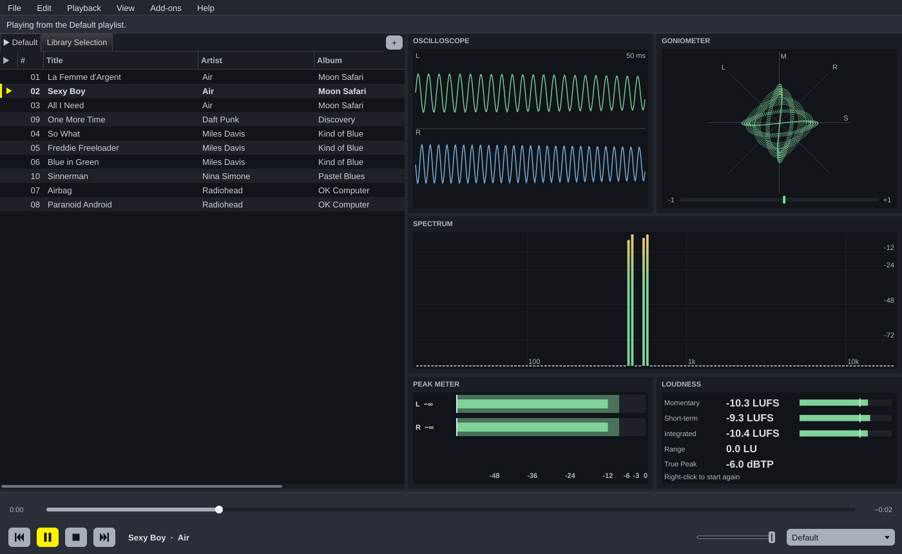

# Kalibre Player: the guide

## The window

From the top:

- **The message line** says what just happened ("12 tracks added"), and on
  the right, work going on ("Converting 3 of 40") with **Stop**. Click a
  message to dismiss it.
- **The panels**, laid out as you choose (below). The first layout has the
  library on the left, the playlist in the middle, and on the right the
  cover, Now Playing and the meters in tabs.
- **The transport** at the bottom: Previous, Play/Pause, Stop, Next; the seek
  bar with the time played and left; what's playing; the volume (double-click
  for 0 dB); and the order.

## Playing

- **Double-click** a track, or choose it and press **Return**. **Space**
  plays and pauses. The keyboard's media keys, AirPods and Control Centre
  work too.
- **Command-Right / Command-Left**: next, previous (previous goes back to
  the start first if more than 3 seconds have played).
  **Command-Shift-Right / Left**: 5 seconds on or back.
  **Command-Up / Down**: louder, quieter.
- **Q** (Edit > Play Next) queues the chosen tracks after this one; the
  playlist's first column numbers them.
- **The order** (the transport's menu, or Playback > Order): Default, Repeat
  Playlist, Repeat Track, Shuffle Tracks (each heard once before any again),
  Shuffle Albums, Random.
- **Playback > Stop After This Track**.
- **Audio CDs**: File > Play Audio CD makes a playlist of the disc.
- Music **inside ZIP, RAR, 7-Zip and gzip files** plays like any other: drop
  the archive on the playlist, or keep it in a library folder.

## Playlists

- Tabs along the top; **+** makes one. Right-click a tab: Rename, Save as
  M3U, Remove. File > Load Playlist opens M3U and PLS files.
- **Drop** files, folders or archives from the Finder onto the playlist,
  where you want them. **Drag** tracks to move them.
- **Click a column's header** to sort by it. **Right-click the header** to
  add a column (any title-formatting pattern, such as `%genre%` or
  `$year(%date%)`), change or remove one. Drag headers to reorder.
- **Right-click tracks**: play, play next, edit tags, files (rename, move,
  copy, show in Finder), convert, ReplayGain, add-ons' items, remove.
- **Edit menu**: remove duplicates, remove missing files, sort, keep only
  the chosen.
- **Autoplaylists** (File > New Autoplaylist, Command-Shift-N) hold what a
  query finds, and follow the library.

## The library

- **Add a Folder** (in the library, or Preferences > Library). The library
  watches it: music added, changed or removed there appears within seconds.
- **Search** (Command-F): words find tracks with all of them anywhere
  ("miles blue"); a query finds exactly ("genre IS jazz AND date BEFORE
  1965"). Help > Search Queries lists them; so does [QUERIES.md](QUERIES.md).
- **Browse**: three columns, by default Genre, Album Artist and Album; each
  column's menu chooses its field (Year, Composer, Folder, Codec, or any tag
  or pattern). Choosing in one narrows the next. Command-click chooses several.
- What's chosen fills the **Library Selection** playlist. Double-click (or
  Return) plays it. Right-click: play, add to the playlist shown, send to a
  new playlist, play next.

## Tags and files

- **Edit Tags** (Command-I): every field of the chosen tracks. A field that
  differs between them shows `<multiple values>` and stays as each has it
  unless you change it. Double-click a value to change it; `; ` between
  values makes several ("Rock; Pop"). Add Field, Remove Field, Number the
  Tracks (1 to n in the playlist's order).
- **Tags from File Names**: a pattern such as `%tracknumber% - %artist% -
  %title%`, or with folders, `%artist%/%album%/%tracknumber% %title%`; the
  preview shows what each file gives.
- **Rename, Move, Copy Files**: a title-formatting pattern for the new name
  (rename) or place (move, copy: `/` makes folders). The preview shows each.
  Playlists and the library follow the files.
- **Title formatting** is foobar2000's: Help > Title Formatting, or
  [TITLE-FORMATTING.md](TITLE-FORMATTING.md).

## Converting and ripping

- **Convert** (Command-Shift-K): FLAC, Apple Lossless, WavPack, WAV, AIFF
  (16 or 24-bit), MP3 (LAME VBR V0 to V6, or constant bit rates), AAC, Opus,
  Ogg Vorbis. A folder, and a pattern for the files' names. Tags and covers
  go with them. **Apply ReplayGain to the Sound** levels the files themselves.
  It uses every core; the message line shows how far it is.
- **Rip Audio CD** (File menu): MusicBrainz is asked for the album and its
  tracks; change any name before clicking Rip. Then as Convert.

## ReplayGain

- **Playing**: Playback > ReplayGain: by track, by album, or by album when
  an album plays in order. Preferences > Playback has the preamps, and
  turning down a track whose peak would clip.
- **Tracks without ReplayGain** are measured as they're queued (Preferences >
  Playback > Measure tracks without ReplayGain as they're queued), so they're
  levelled too, without writing anything.
- **Scanning**: Edit > ReplayGain > Scan per Track, or as Albums (by the
  album tags), writes the tags. Remove ReplayGain Tags takes them out.

## Sound

- **Equaliser**: the Equaliser panel (add it with Edit Layout): ten bands,
  a preamp, presets, On. Playback > Equaliser On.
- **Crossfade**: Preferences > Playback; 0 is gapless.
- **Plug-ins**: Preferences > Plug-ins. Scan once (Options > Scan for New or
  Updated AU/VST3 Plug-ins); then Add puts an effect in the chain. Open shows
  its window; Bypass, Up, Down, Remove. The chain and its settings are kept.
- **Output**: Preferences > Playback chooses the device and its buffer.

## Meters

Oscilloscope, Goniometer (left against right, with the correlation: -1 out
of phase, +1 mono), Spectrum (right-click: bars or a line), Peak Meter
(click to clear the held peaks and clip marks), Loudness (EBU R128:
momentary, short-term, integrated, range, true peak; right-click to start
again). They read what's heard, after the equaliser, plug-ins and volume.

## The layout, themes and keys

- **View > Edit Layout** (Command-E): each panel shows its name and
  **Change…**: Replace With, Add to the Left/Right, Add Above/Below, Add as
  a Tab, Remove. Drag the dividers between panels. Command-E again when
  it's done. **View > Layout** has five ready-made: Library and Playlist,
  Playlist Only, Visualisers, Album Art, Mastering Desk.
- **View > Theme**: Kalibre's twelve. **Command-= / Command--**: text size.
- **Keyboard shortcuts**: Preferences > Keyboard Shortcuts: click + beside
  any command to add a key; they're kept.
- **Now Playing**: right-click it to change what it shows (a pattern).

## Add-ons

Add-ons are Lua scripts. **File > Import Add-on** adds one (a .lua, a folder
with main.lua, or a .zip). Their items are in the **Add-ons** menu and the
playlist's right-click menu. **View > Add-ons** lists them, turns them on or
off, loads them again after editing, and shows the folder. **View > Add-on
Console** shows what they print.

Four come with the player (the .dmg's Add-on Examples folder): Rate Tracks,
Sleep Timer, Now Playing File, Listening Log. Writing one:
[ADD-ONS.md](ADD-ONS.md).

## Where things are kept

`~/Library/Application Support/Kalibre Player`: Library.json, Playlists.json,
Settings.xml (choices, layout, keys, the plug-in chain), Plug-ins.xml (the
plug-ins found), and Add-ons.
