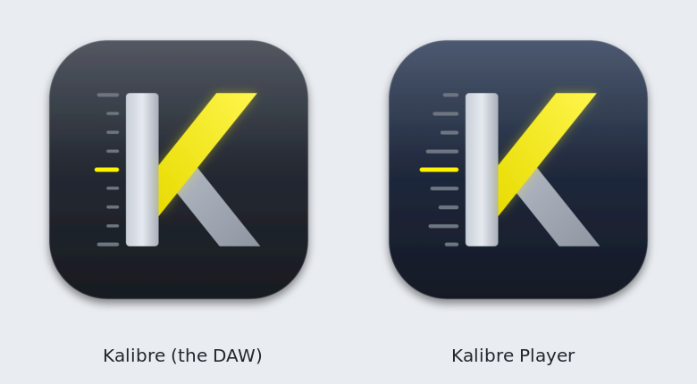

# 0021: An icon of its own, of Kalibre's family

Accepted, 26 November 2026.

The player began with Kalibre's icon (Kalibre's decision 0048), and the
musician asked for one slightly different. It keeps what makes it Kalibre:
the tile, the steel K and its yellow arm. Two things change: the tile is a
deeper blue (#2C3A55 to #141925, where Kalibre's is grey), and the
calibration ticks down the K's left become level bars, long and short as a
meter shows sound, the middle one still yellow. Beside each other in the
Dock or the taskbar they read as two of a family, told apart at a glance.

`Resources/Icon.svg` is the source; `node tools/render-icon.js` draws
`Icon.png` from it (Chromium, through Playwright), which CMake makes into the
Mac's, Windows' and Linux's icons.

