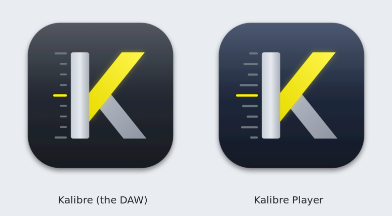

# 26 November 2026: an icon of its own

## What the musician asked, in their words

> Looking good. Can the app logo be slightly different to the Kalibre DAW?

## What was done

- The musician had merged pull request #2 (0.3.0) before the last two
  commits of the session before (the rewritten user guide, the session
  record, 0.3.1) were pushed; the branch was started again from `main` and
  those two put back on it.
- **0.3.2: the player's own icon** (decision 0021). Kalibre's K and yellow
  arm kept; a bluer tile; the calibration ticks made level bars.
  `tools/render-icon.js` draws `Resources/Icon.png` from `Icon.svg`.

## Where it was left

0.3.2 on `claude/sleepy-pasteur-y7ag9n`; `main` has 0.3.0 (pull request #2).
A new pull request brings 0.3.1 and 0.3.2. Still to try by hand, and not
done: as the last record and `docs/FEATURES.md` say.
